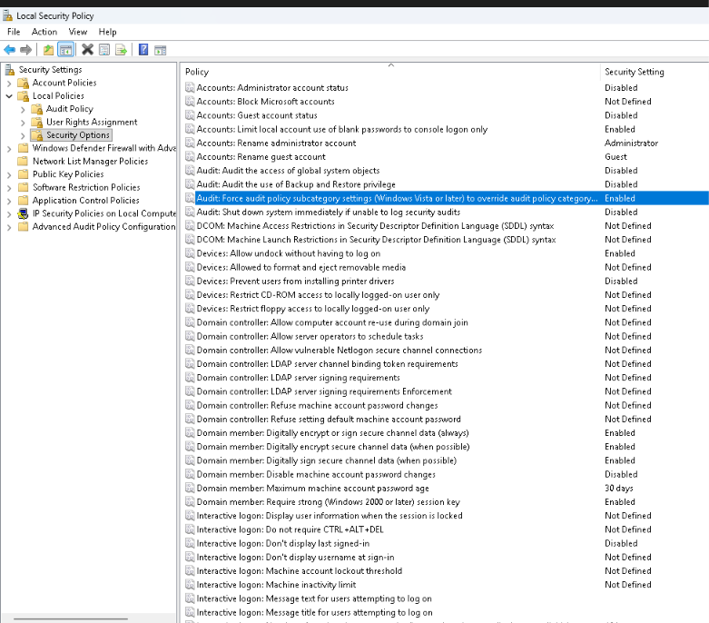
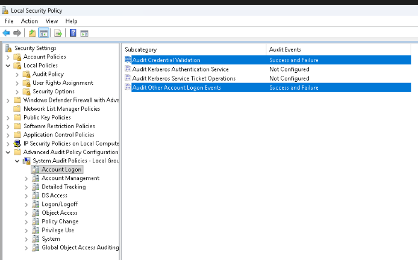
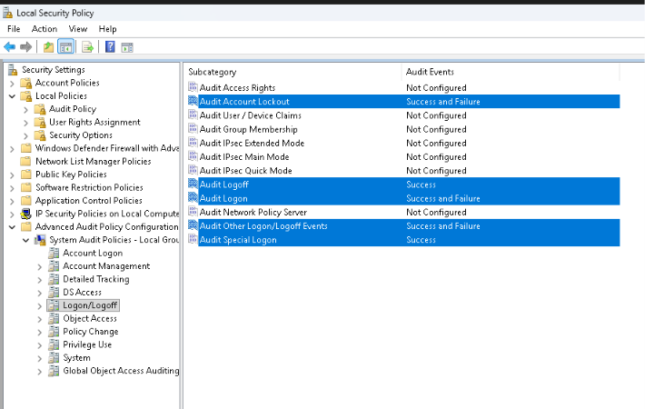
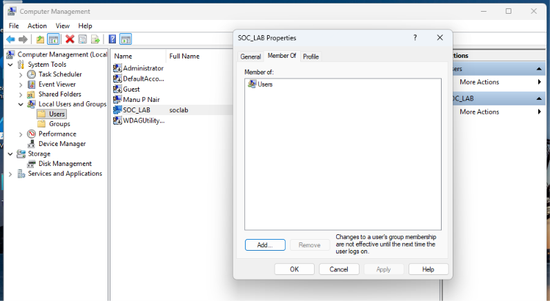
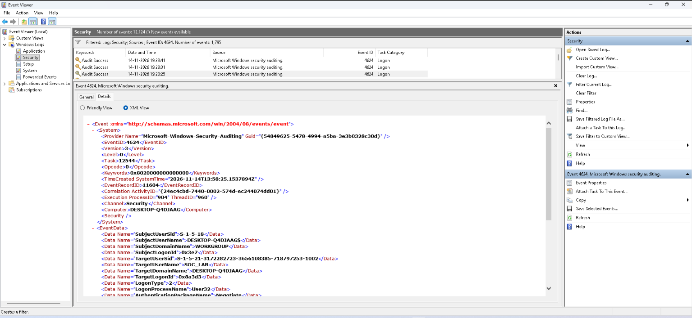
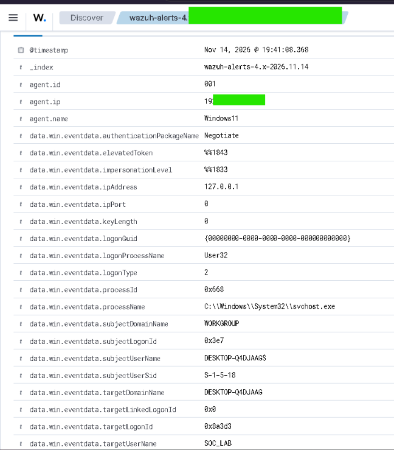
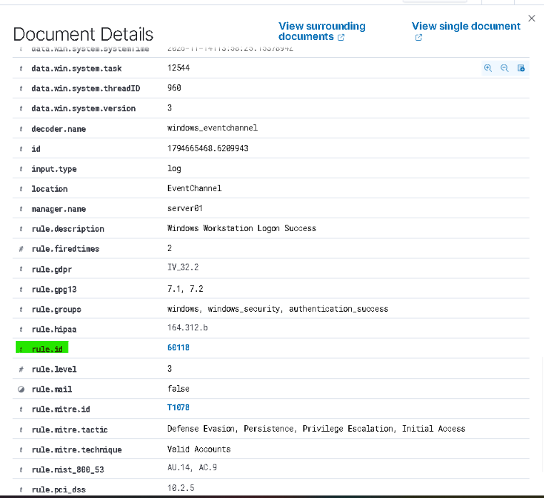

# Scenario 01 – Windows Authentication Monitoring

This scenario demonstrates Windows authentication monitoring and security event investigation using Wazuh SIEM.

## Project Objectives

- Monitor Windows authentication events.
- Identify successful and failed login attempts.
- Investigate Windows Security Event IDs.
- Verify event collection in Wazuh.
- Understand Wazuh detection rules.
- Document basic SOC investigation findings.

## Practical Exercises

1. Successful Login Monitoring

## Evidence and Investigation Results

### 1. Windows Audit Policy Configuration

The Windows audit policy subcategory override was enabled to ensure advanced audit policies take precedence.

### 2. Account Logon Auditing

Credential Validation and Other Account Logon Events were configured for Success and Failure auditing.

### 3. Windows Logon/Logoff Auditing

Windows advanced audit policies were configured to monitor successful and failed authentication attempts, logoff activity, and special logon events.

The following audit settings were verified:

- Audit Logon: Success and Failure
- Audit Logoff: Success
- Audit Other Logon/Logoff Events: Success and Failure
- Audit Special Logon: Success

### 4. Test Account Configuration

The `soc_lab` account was verified as a standard user belonging to the Users group.

### 5. Windows Successful Authentication Event

Windows Event ID 4624 was generated and investigated. The event confirmed a successful interactive login.

### 6. Wazuh Event Collection

The corresponding Windows authentication event was successfully collected and indexed by Wazuh.

### 7. Wazuh Detection Rule

Wazuh matched the event against Rule ID 60118, identifying it as a Windows workstation logon success.

